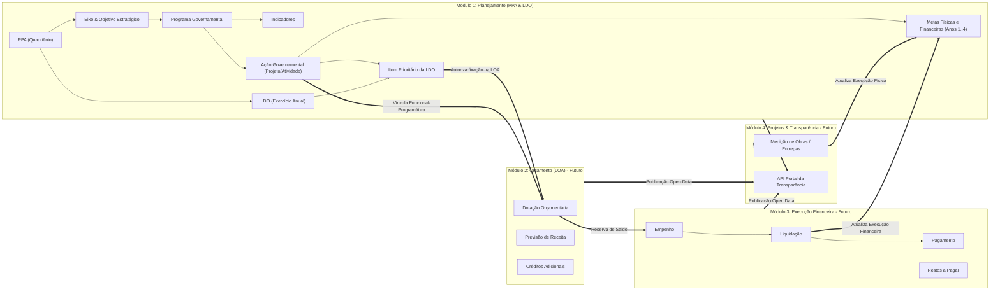
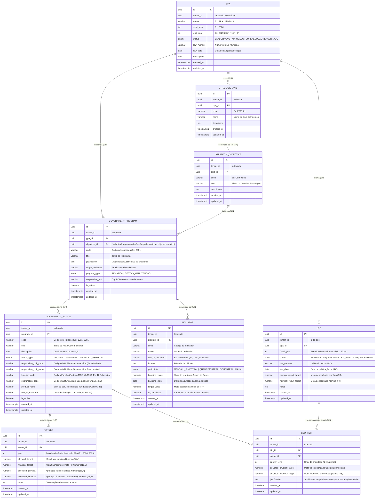

# Arquitetura do Sistema de Gestão de Planejamento, Orçamento e Finanças Públicas (GovTech)

## 1. Visão Geral e Contexto de Domínio

Este sistema foi projetado para atender pequenos e médios municípios brasileiros na gestão integrada de todo o ciclo orçamentário e financeiro público, em conformidade com a **Lei nº 4.320/1964**, a **Lei Complementar nº 101/2000 (Lei de Responsabilidade Fiscal - LRF)** e as normas técnicas da Secretaria do Tesouro Nacional (**MCASP** — Manual de Contabilidade Aplicada ao Setor Público).

O ciclo fiscal público brasileiro é estruturado em três instrumentos de planejamento e orçamento interdependentes, seguidos pela execução orçamentária e financeira:

1. **PPA (Plano Plurianual):** Planejamento estratégico de médio prazo (4 anos). Define os eixos estratégicos, objetivos, programas governamentais (temáticos e de gestão/manutenção), indicadores, ações (projetos, atividades e operações especiais) e metas físicas e financeiras regionalizadas/anualizadas para o quadriênio.
2. **LDO (Lei de Diretrizes Orçamentárias):** Instrumento tático anual que conecta o PPA à LOA. Seleciona as ações prioritárias do PPA para o exercício seguinte (`LDOItem`), ajusta suas metas físicas e financeiras conforme a conjuntura fiscal e define as metas e riscos fiscais.
3. **LOA (Lei Orçamentária Anual):** Orçamento operacional anual que estima as receitas e fixa as despesas por dotações orçamentárias (Unidade Orçamentária + Função + Subfunção + Programa + Ação + Natureza da Despesa + Fonte de Recursos). **Nenhuma despesa pode ser fixada na LOA sem estar compatível com o PPA e a LDO.**
4. **Execução Orçamentária e Financeira:** O estágio da despesa pública (Empenho $\rightarrow$ Liquidação $\rightarrow$ Pagamento), controle de Restos a Pagar (Processados e Não Processados), tesouraria, medição física de obras/entregas e publicação em tempo real no Portal da Transparência.

---

## 2. Decisões Arquiteturais (ADRs)

### ADR-01: Monólito Modular com Domain-Driven Design (DDD Prático)
- **Contexto:** Municípios pequenos exigem implantação enxuta, baixa latência transacional entre Planejamento/Orçamento/Execução e custo operacional reduzido, mas o sistema crescerá em complexidade com os módulos de LOA, Tesouraria e Transparência.
- **Decisão:** Adotar uma arquitetura de **Monólito Modular** em Python 3.11+ com FastAPI, dividindo os *Bounded Contexts* em pacotes independentes dentro de `app/modules/` (`planning`, e futuramente `budget`, `finance`, `transparency`).
- **Isolamento e Evolução:**
  - Cada módulo possui suas próprias camadas internas (`models`, `schemas`, `services`, `routers`, `tests`).
  - A comunicação entre módulos deve ocorrer prioritariamente via camada de `services` (interfaces explícitas) e chaves de referência (UUIDs), evitando acoplamento direto de queries cruzadas em camadas de apresentação.
  - Caso um módulo específico (ex.: `transparency` com alto volume de leitura pública) precise escalar separadamente no futuro, ele pode ser extraído como microsserviço com esforço mínimo.

### ADR-02: Estratégia de Multitenancy (Row-Level Isolation via `tenant_id`)
- **Contexto:** Como solução SaaS GovTech voltada para múltiplos municípios (Prefeituras, Câmaras Municipais, Autarquias/Fundos), o sistema deve isolar rigorosamente os dados de cada ente federativo.
- **Decisão:** Implementar **Shared Database, Shared Schema com Coluna Discriminadora (`tenant_id`)** através do `TenantMixin` aplicado a todas as entidades de negócio.
- **Mecanismo de Segurança:**
  - Todas as tabelas principais contêm `tenant_id: UUID` indexado.
  - Constraints de unicidade negocial são sempre compostas com `tenant_id` (ex.: `UQ(tenant_id, ppa_id, code)` para Programas Governamentais).
  - A dependência de requisição (`get_current_tenant_id`) extrai e valida o identificador do município (via Header `X-Tenant-ID` ou claim JWT) e injeta o contexto na camada de serviço, garantindo que nenhuma consulta ou mutação atravesse fronteiras entre municípios.

### ADR-03: Stack Assíncrona de Alta Performance e Precisão Monetária
- **Banco de Dados e ORM:** PostgreSQL 16 + SQLAlchemy 2.0 utilizando `AsyncSession` e driver nativo `asyncpg`.
- **Tipagem Forte no ORM:** Uso estrito da sintaxe moderna do SQLAlchemy 2.0 (`Mapped[...]`, `mapped_column(...)`).
- **Precisão Financeira:** Todos os valores financeiros e metas físicas utilizam `Decimal` no Python e `Numeric(18, 2)` / `Numeric(18, 4)` no PostgreSQL. **Jamais utiliza-se `float` para valores orçamentários ou monetários**, evitando erros de arredondamento IEEE 754 em contabilidade pública.
- **Validação de Contratos:** Pydantic v2 (`ConfigDict(from_attributes=True)`) com validadores de domínio para garantir invariantes antes mesmo de atingir o banco de dados.

---

## 3. Roadmap de Módulos e Integração entre Contextos



---

## 4. Diagrama Entidade-Relacionamento (DER) — Módulo 1: Planejamento

O diagrama abaixo representa a modelagem relacional implementada para o **Módulo de Planejamento**, detalhando chaves primárias, chaves estrangeiras, `tenant_id` e cardinalidades:



---

## 5. Estrutura de Diretórios do Projeto

```text
.
├── ARCHITECTURE.md                  # Documentação arquitetural e DER
├── pyproject.toml                   # Dependências, configurações do Poetry/Pytest/Ruff
├── Dockerfile                       # Build multi-stage otimizado para produção e dev
├── docker-compose.yml               # Orquestração local (API FastAPI + PostgreSQL 16)
├── alembic.ini                      # Configuração do Alembic
├── alembic/
│   ├── env.py                       # Runner assíncrono do Alembic conectado aos models
│   ├── script.py.mako               # Template de geração de revisões
│   └── versions/                    # Histórico de migrações de banco de dados
└── app/
    ├── main.py                      # Ponto de entrada FastAPI, ciclo de vida e routers
    ├── core/
    │   ├── config.py                # Pydantic Settings (variáveis de ambiente)
    │   ├── database.py              # Engine SQLAlchemy 2.0 assíncrona e sessionmaker
    │   └── deps.py                  # Dependências FastAPI (DB session, X-Tenant-ID)
    ├── shared/
    │   ├── models.py                # DeclarativeBase, UUIDMixin, TenantMixin, TimestampMixin
    │   ├── schemas.py               # Schemas utilitários (PaginatedResponse, ErrorResponse)
    │   └── exceptions.py            # Exceções de domínio padronizadas e handlers HTTP
    └── modules/
        └── planning/                # Módulo 1: Planejamento Municipal (PPA e LDO)
            ├── models/              # Entidades SQLAlchemy 2.0 e Enums de domínio
            ├── schemas/             # Contratos Pydantic v2 (Create, Update, Read, Filter)
            ├── services/            # Casos de uso e validações de negócio (PPA, Programas, LDO)
            ├── routers/             # Endpoints RESTful documentados
            └── tests/               # Testes assíncronos com Pytest e Factory Boy
```

---

## 6. Regras de Negócio Fundamentais Implementadas no Módulo 1

1. **Vigência Quadrienal do PPA:** O PPA deve obrigatoriamente compreender um período de 4 exercícios financeiros consecutivos (`end_year == start_year + 3`), conforme o art. 165, § 1º da Constituição Federal e o art. 35, § 2º, I do ADCT.
2. **Isolamento Multitenant:** Nenhum município pode visualizar, referenciar ou alterar PPAs, Eixos, Objetivos, Programas, Ações ou LDOs pertencentes a outro `tenant_id`.
3. **Unicidade de Códigos no Ciclo:**
   - Um município não pode possuir dois PPAs com o mesmo período (`start_year`, `end_year`) ativos simultaneamente em conflito de código.
   - O código de um `GovernmentProgram` é único por `(tenant_id, ppa_id, code)`.
   - O código de uma `GovernmentAction` é único por `(tenant_id, program_id, code)`.
4. **Coerência Temporal de Metas (`Target`) e LDO (`LDO`):**
   - Toda meta anual (`Target.year`) de uma Ação Governamental e todo exercício de LDO (`LDO.fiscal_year`) devem estar compreendidos dentro do intervalo `[PPA.start_year, PPA.end_year]` ao qual estão vinculados.
5. **Proteção de Ciclo Encerrado:** Ciclos de PPA com status `ENCERRADO` são imutáveis para novas inclusões ou alterações estruturais de programas.
